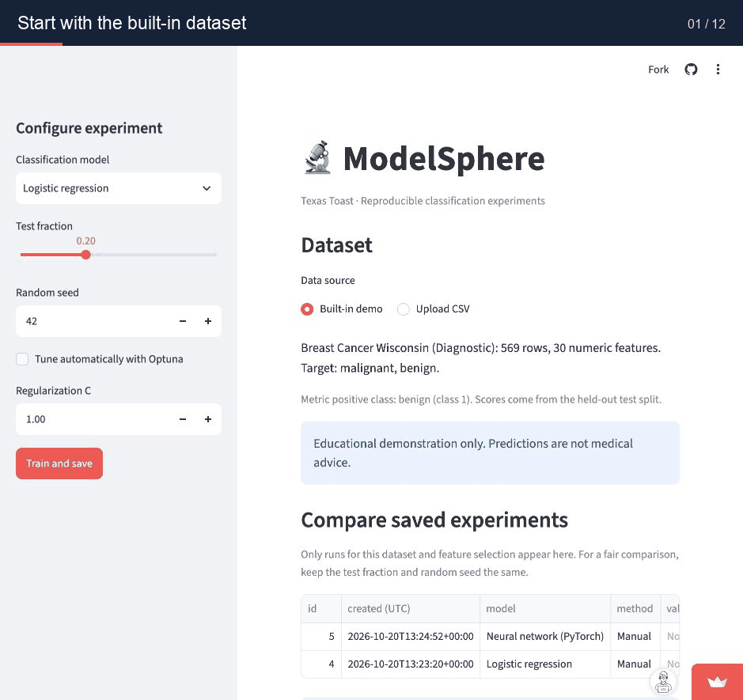

# Project Title: ModelSphere

ModelSphere is a compact machine learning experiment dashboard. It trains three classification models on the built-in Breast Cancer Wisconsin dataset or a small uploaded numeric CSV with a two-class target, evaluates them on a held-out test set, and saves results for side-by-side comparison. Users can optionally tune scikit-learn models with Optuna and compare a new batch's numeric features with the training data. Built by team **Texas Toast** with Streamlit, scikit-learn, PyTorch/Lightning, and SQLite.

## 👥 Team Members & Contributions

All three students have contributed commits to the repository. Their completed work and current areas of ownership are:

* **Oluwasegun Soji-John ([@Oluwasegun-rm](https://github.com/Oluwasegun-rm))** — dashboard comparison, integration, demo, deployment, and Docker packaging ([issue #1](https://github.com/Oluwasegun-rm/modelsphere/issues/1))
* **Dawaun Shields ([@WaunCPU](https://github.com/WaunCPU))** — training validation, repeatable evaluation, and bounded Optuna tuning ([issue #2](https://github.com/Oluwasegun-rm/modelsphere/issues/2))
* **Eian Capers ([@Eicap1-prog](https://github.com/eicap1-prog))** — SQLite experiment saving, numeric data-drift checks, and optional AI Experiment Insights ([issue #3](https://github.com/Oluwasegun-rm/modelsphere/issues/3))

The initial scaffold was created with Codex; it is not represented as a student's individual work. GitHub history shows each student's later contributions.

---

## 🚀 Live Demo

* **Application URL:** [ModelSphere on Streamlit Community Cloud](https://efpmqnyhgu7aepxpdqxxi2.streamlit.app/)

The public app was opened and both classifiers were trained successfully on October 19, 2026. Local SQLite history on Community Cloud may reset after an app restart.

### 🎥 Project Walkthrough



The GIF shows actual frames from the live app: model selection, configuration, and saved results.

---

## 🛠️ Installation & Setup

### Prerequisites

Python 3.11 or 3.12, `pip`, and Git.

### Local Installation

```bash
git clone https://github.com/Oluwasegun-rm/modelsphere.git
cd modelsphere
python -m venv .venv
source .venv/bin/activate  # Windows: .venv\Scripts\activate
python -m pip install -r requirements.txt
streamlit run app.py
```

Run automated checks with `python -m pytest -q` and the non-UI smoke check with `python -m scripts.smoke_test`.

For a guided first run and a fair model comparison, follow the [local walkthrough](docs/local_walkthrough.md).
For CSV limits, validation, and saved-run behavior, see the [upload guide](docs/upload.md).
To build and run the same app in Docker, follow the [container guide](docs/container.md). The Docker image is checked in GitHub Actions; the public demo runs on Streamlit Community Cloud.

---

## 📊 Dataset

* **Source:** [UCI Breast Cancer Wisconsin (Diagnostic)](https://archive.ics.uci.edu/dataset/17/breast+cancer+wisconsin+diagnostic), accessed through [scikit-learn's bundled loader](https://scikit-learn.org/stable/modules/generated/sklearn.datasets.load_breast_cancer.html).
* **Description:** 569 observations, 30 numeric features derived from breast mass images, and a binary malignant/benign label. In scikit-learn, class 0 is malignant and class 1 is benign.
* **Data pipeline:** `load_breast_cancer()` supplies the data with the package. The app makes a stratified 80/20 split by default; the random seed and test fraction are configurable. No data file needs to be downloaded separately.

Users may instead upload a UTF-8 CSV under 5 MB, choose a two-class target and up to 50 numeric feature columns, inspect missing values and class counts, and train the same models. Missing numeric values are filled using medians fitted on training data only. Rows without a target are excluded with a visible count; exact duplicates are reported but kept. Uploaded rows are not saved in experiment history. History records a fingerprint and the selected dataset settings so comparisons stay within one dataset and feature selection.

This is an educational dataset and app, not a clinical diagnostic tool.

---

## 🧠 Model Architecture & Training

* **Algorithms:** Logistic regression with configurable regularization strength C; random forest with configurable tree count and maximum depth; a small one-hidden-layer PyTorch neural network with configurable epochs, hidden units, and learning rate.
* **Frameworks:** scikit-learn for data preparation, baselines, and evaluation; PyTorch for the neural model and loss; Lightning for its bounded CPU training loop; Optuna for optional hyperparameter search on the two scikit-learn models; Streamlit for the interface; SQLite for experiment records.
* **Training process:** A stratified train/test split keeps the holdout data out of fitting. Missing values are imputed using training medians; logistic regression and the neural network scale features using training data only. Random forest uses a fixed random seed. The neural network trains for at most 20 epochs on CPU. Optional Optuna tuning tries at most 20 settings for a scikit-learn model, using cross-validation on training rows only; the chosen model is then scored once on the held-out test rows. The app saves settings and metrics, not model binaries or row-level data.

The **Check data drift** section compares training features with a new batch, either an uploaded CSV or a clearly labelled built-in example. It reports a per-feature distribution gap and a plain-language status. This is an input-data warning, not a prediction of future drift or a measurement of model accuracy. At least 30 usable values per feature are needed in each batch. The check does not send alerts or save monitoring history. Predictive alerts and dynamic container scaling are not implemented in this release.

The **AI Experiment Insights** section (`src/insights.py`) is optional. After you pick saved runs and click **Generate AI Insights**, it asks an OpenAI model to explain them in plain language and suggest things to try. Only model settings, row counts, and aggregate test metrics are sent, for at most the five newest selected runs. Dataset rows, filenames, and column names are never sent. The text is labelled as AI-generated suggestions, separate from the measured results, and it cannot change any setting. Nothing is called until the button is clicked. Without an API key, without the `openai` package, or if the API fails, the app shows a clearly labelled local summary instead and keeps working. To enable it, set `OPENAI_API_KEY` (and optionally `OPENAI_MODEL`) as an environment variable locally or in Streamlit secrets when deployed; never commit the key. Automated tests use a fake client, and the live OpenAI response in the public deployment has not yet been confirmed.

---

## 📈 Evaluation & Results

The following values were observed in the live demo with an 80/20 stratified split and seed 42 (455 training, 114 test rows). Test metrics use **benign (class 1)** as the positive class. Training metrics are intentionally not reported as generalization results.

| Model | Test accuracy | Test precision | Test recall | Test F1 | Test ROC AUC |
| :--- | ---: | ---: | ---: | ---: | ---: |
| Logistic regression (C=1.0) | 0.982 | 0.986 | 0.986 | 0.986 | 0.995 |
| Random forest (100 trees, unlimited depth) | 0.956 | 0.959 | 0.972 | 0.966 | 0.994 |

These are results from one fixed split of a small, easy dataset; they do not establish clinical suitability. The dashboard reports all five metrics for each new run and displays saved runs in a comparison table.

---

## 🧑‍💻 Git Workflow & Guidelines

1. Create a feature branch for your issue, such as `feature/training-validation`.
2. Pull the latest `main` before starting and before opening a pull request.
3. Make genuine, descriptive commits from your own account; open a pull request early.
4. Run `python -m pytest -q` and keep `streamlit run app.py` working.
5. Merge working core improvements before optional features. Keep this README accurate about what is live.

The [implementation plan](docs/implementation_plan.md) maps the course brief to current and next work. The detailed task split is in [team tasks](docs/team_tasks.md), and agent development rules are in [AGENTS.md](AGENTS.md). GitHub Actions runs the tests and container checks on pushes and pull requests.

## 🎓 Understand and present the project

The [architecture guide](docs/architecture.md) explains the data flow, every major file, the training and evaluation design, model choices, metrics, and technology choices. The [presentation script](docs/presentation.md) gives the team a short live demo plan and answers to likely class questions. The [local walkthrough](docs/local_walkthrough.md) shows how to train and compare two experiments step by step.
